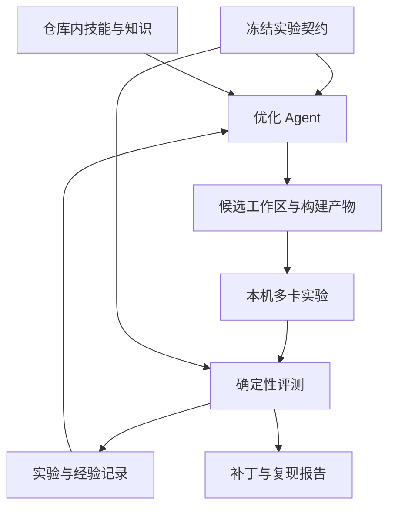

# AFD-RSI 本机 MegaMoe 优化框架方案

日期：2026-10-23。

状态：建设基线方案。当前实现状态与使用方法见本仓库 README；本文的后续能力不代表已经实现或通过 NPU 验证。

建议仓库名：`afd-rsi`。

## 1. 目标与首版范围

建设面向 afd-plugin MegaMoe 的本机优化工作台：以仓库内固化的 Ascend 算子技能和知识为底座，由 coding agent 提出并实现候选，通过独立的本地多卡实验判定收益，将结果转化为后续优化可使用的经验。

首版面向单机 Linux、多张本地 NPU。控制程序、源码工作区、构建、Attention/FFN 进程和结果收集均位于本机。用户预先提供可用设备、软件环境、目标源码和必要模型资产。

首版交付一个完整闭环：

1. 固定实验目标、基线、工作负载、预算和判据。
2. 读取仓库内技能与知识，核对当前实现和运行路径。
3. 生成有证据支持、可以被实验否定的优化假设。
4. 在独立工作区形成最小候选补丁并构建。
5. 验证正确性，进行基线与候选的性能对照和复测。
6. 接受或拒绝候选，保留成功、失败与证据不足的记录。
7. 输出候选补丁、可复现配置、证据和适用范围。

首版不建设 iTASK、SSH、其他远程执行接口、调度平台适配、资源申请系统、多 agent 调度服务、Web UI、向量数据库或模型训练。没有预先设计的远程适配层。

框架独立实现，不导入或复制其他 RSI 框架的运行时代码。采用实验契约冻结、对照测量、完整证据和结论分级等工程方法。

## 2. 与 afd-plugin 的边界

`afd-rsi` 是开发工具仓库，afd-plugin 是被优化的目标仓库。推理服务不依赖 `afd-rsi`。

| 内容 | 所属位置 |
| --- | --- |
| 优化流程、技能、知识、评测规则、实验记录格式 | afd-rsi |
| MegaMoe Kernel、Host/Tiling、注册、绑定、运行时接入 | afd-plugin |
| 生产接口与行为的回归测试 | afd-plugin |
| 独立比较输入、参考计算、计时与跨候选判定 | afd-rsi |
| 权重、构建产物、大型原始数据 | 用户提供的本地资产目录或实验目录 |

目标仓库以源码快照和候选补丁关联，不把整份 afd-plugin 复制进框架源码。默认不修改用户原工作区；候选修改发生在实验专属工作区。

当前规划以 A3、layered W4A8、BF16 输出、Async CAM compact_v2 为首个任务范围。正式实验仍须从实际配置与调用路径确认支持组合，不把设计假设当作已验证能力。

首个目标路径的职责划分为：

- Attention：路由、发送、共享专家、返回结果的最终加权与合并。
- FFN：接收整理、GMM1、SwiGLU/量化、GMM2、回传。
- 两端共同遵循通信协议，但各自运行独立的设备入口。

保留两条性能参照：固定起点基线与当前最佳候选。若需要证明 MegaMoe 的集成价值，还要与同配置的 layered 路径比较。eager 和 FULL 分别建立比较，不能混合计分。

## 3. 核心架构



| 模块 | 职责 | 首版实现 |
| --- | --- | --- |
| Campaign | 配置冻结、阶段推进、预算、恢复 | 一个 Python 控制进程 |
| Skills | 本地技能与知识的校验、适用性选择、上下文组织 | 文件清单与内容读取 |
| Agent | 解释证据、提出假设、修改候选、形成经验草稿 | 接入一种现有 coding-agent CLI |
| Runner | 快照、构建、本机多 rank 生命周期、采样与收集 | 本地子进程与进程组 |
| Evaluator | 核验证据、计算指标、判定正确性和收益 | 独立 Python 程序 |
| Evidence | 保存原始结果、候选关系、经验、报告 | JSON/JSONL 与 Markdown |

Agent 提出候选，Evaluator 作出判定。Agent 自报的正确性、耗时和收益不能替代执行器采集的数据。

模型调用按阶段使用独立上下文，不需要多个常驻 agent。控制程序不依赖 NPU Python 包；只有 benchmark 子进程导入实际 NPU 依赖。

## 4. 技能与知识必须固化到仓库内

### 4.1 固化原则

固化意味着正文和必要依赖真实存在于仓库中，并随版本提交。只保存技能名称、网址、安装命令、摘要或哈希，不算完成固化。

必须满足：

1. `skills/` 包含完整的技能入口、阶段流程、模板和必要脚本。
2. `knowledge/` 包含运行所需的架构知识、API 合同、优化方法、协议说明、检查规则和必要参考代码。
3. 技能使用的资源全部能够在仓库内解析；跨技能依赖也必须完整纳入。
4. 不依赖用户全局技能目录、其他 checkout、指向仓库外的符号链接或运行时动态下载。
5. 不通过 Git submodule、LFS 下载指针或外部页面代替必需的技能与知识正文。
6. 运行时不通过网络补齐知识，不自动更新底座。
7. 清单中的版本与哈希用于校验实际内容，不能替代内容本身。

目标代码、CANN 工具链、模型权重属于实验依赖，按实验契约提供。它们不属于必须全部内置到框架中的知识正文；但运行所必需的 API 说明和能力约束必须有仓库内版本。

保留迁入材料的许可证、归属、版本和改写记录；这些是审计信息，不是运行时读取外部内容的入口。正文不能以“详见外部资料”代替必要说明。无法合法纳入的材料不得用空链接冒充固化完成，该项能力应明确为未就绪。

### 4.2 固定内容与演进内容

| 层次 | 内容 | 变更方式 |
| --- | --- | --- |
| 基础技能 | 流程、适用条件、输入输出、检查要求 | 维护者提交新版本，当前 campaign 内只读 |
| 基础知识 | 架构、API、通信协议、数值语义、参考实现 | 审查后更新；重新生成内容清单 |
| 实验契约 | 输入、判据、基线、指标、预算、评测代码身份 | 搜索前冻结，变更后新建实验版本 |
| 实验经验 | 成功、失败、未确认假设及证据 | 实验追加记录，不能覆盖基础约束 |
| 优化策略 | 候选优先级、上下文选择、实验顺序 | 首版保持简单；后续进行受控比较 |

基础技能更新后不能继续把新旧结果当作同一搜索条件。已经开始的 campaign 使用其锁定快照，或结束后创建新 campaign。

### 4.3 首批仓库内技能

下表名称是计划固化在本仓库中的能力入口，不是要求运行环境安装同名外部技能。迁入时必须同时处理原有脚本、资源和隐含工具依赖。

| 仓库内技能 | 必须包含的能力 | 阶段产物 |
| --- | --- | --- |
| `npu-arch` | 架构识别、能力限制、资源查询方法 | 平台能力与适用范围 |
| `ascendc-operator-development` | 工程结构、Host/Tiling/Kernel/API 合同、构建与注册 | 修改落点与完整构建链 |
| `ascendc-mc2-best-practice` | 通信路线、融合设计、状态协议、可见性与同步 | 数据流和状态生命周期说明 |
| `ascendc-perf-optimize` | Tiling、卡间、核间、核内四步分析 | 瓶颈假设与实验计划 |
| `ascendc-performance-best-practices` | 对应架构的 GMM、量化、搬运、buffer 与流水方法 | 可执行候选与适用条件 |
| `ascendc-code-review` | Host、Tiling、Kernel、绑定和调用契约检视 | 检查结果与待验证风险 |
| `ascendc-crash-debug` | 卡死、崩溃、越界、同步异常定位 | 故障身份、原因假设与回归步骤 |
| `afd-megamoe` | A/F 边界、协议、W4A8、图执行、目标仓库定位 | 当前优化对象与不可改变的语义 |

首版固化 A3 MegaMoe 所需的完整依赖闭包，不搬入大量无关平台材料。没有纳入正文和验证流程的能力不得标记为支持。

### 4.4 必须固化的知识

| 类别 | 必须写入仓库的内容 |
| --- | --- |
| 平台 | SoC 与架构识别、AIC/AIV 资源获取、存储层级、指令与数据格式限制 |
| API | 实际使用 API 的参数、对齐、作用域、同步要求、错误返回与版本条件 |
| 通信 | window 布局、访问方式、payload/状态发布顺序、消费者与清理时机 |
| 计算 | GMM1/GMM2 数据流、W4A8 scale/补偿、SwiGLU、舍入、输出缩放 |
| AFD | rank 映射、layer 选择、expert chunk、输入去重、返回顺序、最终完成语义 |
| 性能 | 各类计时定义、预热、对照设计、资源可行性、profiling 的扰动边界 |
| 故障 | 同步配对、越界与踩踏、图 replay、状态复用、异常退出的检查方法 |
| 参考代码 | 解释或实施首批候选必需的最小完整实现、构建条件与适用范围 |

技能描述“什么时候做、怎么做、交付什么”；知识描述“事实、约束和证据是什么”。同一事实保持一个仓库内正文来源，避免多份内容漂移。

每份知识正文记录标识、内容版本、适用架构、工具链范围、事实或假设状态、证据范围，以及关联的仓库内材料。未知版本不能默认视为兼容。

### 4.5 固化验收

第一阶段必须检查：

- 所有必需资源实际存在，清单哈希匹配。
- 所有内部资源路径解析后仍位于仓库内。
- 无全局技能路径、仓库外软链接、动态 fetch/install 等隐含依赖。
- 脚本和模板依赖已列清，适用流程与当前执行器能力一致。
- 在不读取全局技能和外部知识目录的情况下，可以完成上下文装配和一次 CPU 流程演练。
- 完整固化验收中，coding agent 只暴露本仓库能力包；模型服务访问可用，但不能用在线检索代替缺失知识。

原始技能若依赖专用插件、远程工具或复杂多 agent 调度，应在迁入时改造成首版可执行的本地流程，并记录差异。不能只复制 `SKILL.md` 后声称能力就绪。

## 5. 仓库结构

```text
afd-rsi/
├── pyproject.toml
├── AGENTS.md
├── README.md
├── src/afd_rsi/
│   ├── cli.py
│   ├── contracts.py
│   ├── campaign.py
│   ├── skills.py
│   ├── agent.py
│   ├── workspace.py
│   ├── runner.py
│   ├── evaluate.py
│   └── evidence.py
├── skills/
│   ├── manifest.json
│   ├── npu-arch/SKILL.md
│   ├── ascendc-operator-development/SKILL.md
│   ├── ascendc-mc2-best-practice/SKILL.md
│   ├── ascendc-perf-optimize/SKILL.md
│   ├── ascendc-performance-best-practices/SKILL.md
│   ├── ascendc-code-review/SKILL.md
│   ├── ascendc-crash-debug/SKILL.md
│   └── afd-megamoe/SKILL.md
├── knowledge/
│   ├── manifest.json
│   ├── architecture/
│   ├── api/
│   ├── mc2/
│   ├── gmm-quantization/
│   ├── afd/
│   ├── measurement/
│   ├── troubleshooting/
│   └── reference-code/
├── benchmarks/megamoe/
│   ├── workload.py
│   ├── reference.py
│   ├── correctness.py
│   └── performance.py
├── recipes/megamoe_a3.toml
├── tests/
│   ├── unit/
│   ├── integration/
│   └── npu/
└── docs/
    ├── architecture.md
    ├── experiment-contract.md
    ├── measurement.md
    └── knowledge-maintenance.md
```

技能自身的阶段脚本与模板保存在对应技能目录，技术正文和公共参考代码保存在 `knowledge/`。运行时通过仓库内标识定位，完整内容均由 Git 管理。

控制程序优先使用标准库：配置用 TOML，结构定义用 dataclass，记录用 JSON/JSONL，本地执行用 subprocess。首版不引入数据库或通用工作流引擎。

`runs/`、候选工作区、模型权重、构建产物和大型 profiling 原始文件不提交。小型测试 fixture 和经整理的基础知识必须随仓库提交。

## 6. 实验契约与数据结构

用户配置表达意图；框架在准备阶段生成不可变的 `plan.lock.json`。必要的基线校准在搜索前完成，判据冻结后才能生成正式候选。

| 契约 | 必须包含的信息 |
| --- | --- |
| 源码身份 | 目标版本、未提交修改和新增文件的内容指纹、依赖版本 |
| 修改范围 | 允许修改的文件、允许改变的行为、必须保持的接口与协议 |
| 环境 | 实际 SoC、CANN、驱动、torch_npu、vLLM、编译工具与参数 |
| 拓扑 | 本地设备映射、A/F role rank、通信 world rank、TP、专家放置 |
| 负载 | shape、dtype、量化、路由分布、随机种子、容量、执行模式 |
| 正确性 | 独立参考、误差定义、数值门槛、必须通过的边界集合 |
| 性能 | 主指标、计时边界、逐 case 约束、汇总方法、收益门槛 |
| 测量 | 预热、重复次数、AB/BA 顺序、初筛/复测、异常样本规则 |
| 预算 | 总时间、候选数量、agent 调用或 token 预算、单阶段超时 |
| 框架身份 | skills/knowledge 清单哈希、benchmark、Evaluator、策略版本 |

最少维护以下对象：

- `CampaignPlan`：锁定条件、范围、预算和验收规则。
- `Candidate`：父候选、假设、补丁、修改范围和构建身份。
- `Trial`：执行角色、输入身份、原始采样、日志、退出状态和清理状态。
- `Verdict`：所判定的范围、通过/失败/证据不足、理由及原始证据。
- `Experience`：适用条件、假设、观测、结论、证据与局限。

阈值不从技能示例自动继承，也不能根据候选结果事后调低。预算缺失不代表无限运行。

## 7. 单轮优化流程

```text
分析证据
→ 提出假设
→ 校验适用范围
→ 修改候选
→ 构建与代码检查
→ 正确性验证
→ 性能初筛
→ 独立复测
→ 接受/拒绝/证据不足
→ 归档与下一轮
```

每轮围绕一个主要假设，允许它带来必要的配套修改。每个候选必须说明：

1. 当前瓶颈是什么，证据来自哪里。
2. 准备改变什么，涉及哪些调用者、配置、构建项和测试。
3. 预期哪个指标改变，为什么。
4. 观察到什么会推翻该假设。
5. 哪些数值、通信和运行时语义必须保持。

性能分析按四步展开：Tiling 建模、卡间流水、核间流水、核内流水。条件不满足的阶段注明不适用；缺少必要 Tiling 或隔离测量时补采数据，不直接宣布瓶颈成立。

AFD 专有协议和非对称角色决定具体适用条件。不能把对称 EP 的 local expert 路径、不同架构的指令或不兼容通信路线直接套到当前实现。

首版使用简单候选队列：先处理证据较充分、修改较小、验证成本可控的候选。拒绝重复提交已经被同条件实验否定且没有新证据的假设。

停止条件包括预算耗尽、完成既定目标、候选队列耗尽，或环境/清理状态不满足继续运行要求。没有收益也必须交付完整记录。

## 8. 首批搜索空间

| 方向 | 候选内容 | 必须联动检查 |
| --- | --- | --- |
| Tiling | tile 大小、分块、尾块 | workspace、循环边界、对齐和所有关联参数 |
| 搬运 | 冗余拷贝、布局转换、临时区 | 数据有效范围、顺序、生命周期 |
| 计算 | GMM 参数、局部融合、buffer 使用 | W4A8 scale/补偿、舍入、激活、输出缩放 |
| 核间调度 | 工作分配、同步粒度 | 参与者集合、资源预算、可见性和状态复用 |

第一轮可以评估 tile/Tiling，但先确认 baseline 已通过正确性验证。一次 kernel launch 不等于已形成通信与计算重叠，也不能作为收益证据。

A/F 协议变化、量化算法变化、跨工作项调度、Attention 侧行为变化不进入首个搜索空间。它们需要独立契约和双端回归范围。

## 9. 本地构建与进程执行

### 9.1 源码与产物隔离

- 为基线与候选建立独立工作区和构建目录。
- 将用户未提交修改和新增文件一起纳入起点快照，不静默丢弃。
- 构建结果记录编译命令、退出码、工具链和产物哈希。
- 启动时核验实际加载的 Python 包、动态库、OPP 路径及版本。
- 每个 rank 上报环境、设备映射和加载身份；混用基线与候选产物的 trial 无效。
- 切换候选后启动新进程，避免已加载动态库和旧通信状态污染结果。
- 默认不进行系统级安装，不覆盖其他实验使用的共享产物。

独立目录本身不能证明执行隔离，必须结合实际加载路径、产物身份、有效配置与 kernel 执行证据。

### 9.2 多 rank 生命周期

Runner 直接启动当前测试需要的本地 Attention/FFN 进程，显式传入角色、设备、通信配置和实验 ID。

启动前核对设备可用性和相关进程占用。框架管理自身设备使用记录，但不将本地锁当作对其他程序的全局隔离保证。

每个 trial 有唯一 ID、独立日志、进程身份、完成文件和截止时间。所有 rank 的结果完整后才能结束测量。

异常时按顺序保存现场、停止本 trial 的进程组、确认子进程退出、检查资源和设备状态。只处理本框架启动的进程，不执行全局进程清理或自动设备重置。

无法确认清理完成时停止后续调度。控制程序重启后先核对原 trial 是否仍在运行，不能根据旧日志或丢失响应直接重复启动。

## 10. 正确性与性能评测

### 10.1 三类首版测试

| 测试 | 目的 | 关键控制 |
| --- | --- | --- |
| 正确性 | 数值、路由、计数、边界和重复调用 | 固定输入、独立参考、冻结误差标准 |
| FFN 工作项 | 比较完整 FFN 路径 | 明确输入就绪条件、相同工作量、覆盖相关流依赖 |
| A→F→A 事务 | 验证实际收发和计算的整体表现 | 在同一 Attention 端时钟域定义完成区间 |

独立参考不能由候选代码自行产生。先用可解释的小规模数值参考校验核心语义，再使用锁定的既有路径做较大规模差分；差分一致本身不等于数学参考正确。

正确性至少覆盖：空 expert、零工作量、热点 expert、容量边界、非整 tile、层切换、连续 launch、重复 graph replay，以及当前接口声明支持的 shape 与 dtype。

候选可以新增开发测试，但不能修改已冻结的验收测试、参考输出和误差标准。特定 fixture 的容差不能直接推广为整个 W4A8 路径的容差。

### 10.2 时间与指标定义

- 明确区分单 kernel 时间、FFN 完整工作项时间、A→F→A 事务时间和服务请求时间。
- A/F 角色异构，最慢 rank 的单 kernel 时间不能直接代表事务完成时间。
- 不对未校准的不同设备时钟做时间戳相减。
- kernel 时间使用验证过的设备计时或 profiler；主机时间只用于其明确声明的工作项、请求或控制层范围。
- 跨流完成时间需要覆盖实际依赖，不能只等待其中一条 stream。
- 阶段跨度、PMU 活跃时间和关键路径延迟分别记录。
- 逻辑 DMA 字节不能标成物理链路字节。
- 当前架构的周期换算和探针有效性应在仓库知识中有依据，并与实际平台核对。

正式性能测量与诊断 profiling 分开执行。侵入式探针、错误检查和细粒度采样结果不能混入普通运行的主指标。

### 10.3 对照与统计

- 基线和候选使用相同输入、路由、payload、容量、执行模式和软件条件。
- 所有影响性能的优化开关记录实际生效值，不能只记录启动命令。
- decode、prefill 和不同图执行模式分别给出结果。
- 使用预先确定的 AB/BA 交替顺序、预热与重复策略。
- 样本排除规则在搜索前冻结，不删除有效的慢样本。
- 逐 case 保留结果和退化检查；汇总分数不能掩盖关键 case 回退。
- 多 rank 和同一次 launch 的观测存在关联，不能当作独立重复样本扩大置信度。
- 初筛胜出后使用新一批数据复测，控制大量候选搜索带来的偶然胜出。
- P99 等尾部结论需要足够样本；样本不足时报告限制。

如需分析通信瓶颈，分别构造单段延迟、目标端 fan-in、GMM 争用实验。固定 `batch_info`、payload 和每 sender 字节量，并区分 ready backlog 与真实并发到达。

解释通算重叠前核对 AIC/AIV 物理资源预算、核启动分散和可行配置对照。不能用超额分配产生的时间线直接证明通信与计算有效重叠。

### 10.4 验证结论的范围

首版可以形成算子或事务范围的结论。真实 checkpoint 质量、服务吞吐、请求尾延迟和长时间稳定性需要相应实验，缺少这些实验时不能宣称生产服务已获益。

## 11. 判定、候选晋升与恢复

执行状态与评测结论分别记录。构建失败、运行超时、取消、设备异常、采集失败属于执行信息；正确性和性能是否达标属于评测信息。

| 结论 | 定义 |
| --- | --- |
| `PASS` | 所声明范围的证据完整，所有必要判据满足 |
| `FAIL` | 有效实验明确显示某项必要判据不满足 |
| `INCONCLUSIVE` | 环境、执行或证据缺失使结论无法成立 |

输出错误是正确性失败；有效测量没有达到收益门槛是性能失败；只有部分 rank 数据、产物不一致或未知原因中断则不足以形成性能结论。若已通过独立证据确认候选引入稳定性缺陷，应单独记录该稳定性失败，不能被性能数据缺失掩盖。

候选晋升必须经过正确性、初筛、复测和必要的集成检查。报告同时呈现相对固定基线与当前最佳候选的变化。

恢复只继续未完成阶段。原始失败与中断记录不覆盖；重跑使用新的 attempt ID，并说明原因。读取已有证据可以恢复状态，不重新解释旧 trial 的输入与判据。

## 12. 经验闭环与 RSI 边界

首版自动积累结构化经验，让下一轮候选选择使用已有结果。每条经验包含适用范围、假设、修改、观测、结论、证据与局限。

经验分为：

- 已验证：在声明的输入、环境与版本下有完整证据。
- 已否定：在同条件下被有效实验推翻。
- 待确认：只有静态分析、缺少重复测量或证据不完整。

检索先按架构、量化、协议、执行模式、shape 和瓶颈类型筛选，再读取少量相关记录。首版使用普通文件检索，不建设向量检索系统。

Agent 可以提出经验草稿；框架检查其引用的实验和结论是否一致。经验进入下一轮上下文不等于已经升级为基础知识。将经验固化进 `knowledge/` 需要单独审查和必要的复现。

首版实现的是经验驱动的优化闭环，不声称已经证明优化器自身持续变强。后续策略自改进可更新候选优先级、上下文选择和实验顺序，但必须在相同模型、预算、起点和独立任务上比较新旧策略。Evaluator、基础 skills、知识事实与资源清理逻辑不参与自动搜索。

## 13. 证据与交付

```text
runs/<campaign>/
├── plan.lock.json
├── environment.json
├── foundation/                 # 本次实际使用的技能与知识内容快照
├── baseline/
├── events.jsonl
├── candidates/<candidate>/
│   ├── hypothesis.json
│   ├── change.patch
│   ├── build.json
│   ├── correctness.json
│   ├── measurements.json
│   ├── verdict.json
│   └── trials/<attempt>/
│       ├── processes.json
│       ├── artifacts.json
│       ├── cleanup.json
│       └── logs/
├── experience.jsonl
└── report.md
```

`foundation/` 保存本轮使用的实际内容及清单，防止后续仓库更新使旧实验依赖丢失。运行快照来自本仓库，不能回退读取外部技能。

报告包含目标、输入范围、修改原因、完整配置、逐 case 结果、原始数据位置、失败候选、接受理由和未验证边界。

导出的交付包包含补丁、原始源码身份、必要的新文件、实验锁定配置、最小复现入口和结果摘要。复现说明使用可替换路径，说明输入生成、角色布局、环境条件和实际命令，不依赖作者私有目录。

框架不自动合并候选。合入 afd-plugin 前，对最终提交及其构建产物重新执行声明范围内的验证，避免将实验补丁结果直接外推到不同提交。

## 14. 拟定命令流程

以下为设计接口，尚未实现：

```bash
afd-rsi check recipes/megamoe_a3.toml
afd-rsi prepare recipes/megamoe_a3.toml
afd-rsi baseline runs/<campaign>
afd-rsi search runs/<campaign>
afd-rsi report runs/<campaign>
afd-rsi export runs/<campaign> --candidate <candidate>
```

- `check`：检查仓库内技能与知识闭包、目标源码和本地环境，不运行优化搜索。
- `prepare`：建立源码与能力快照，完成配置允许的前置检查和基线校准，冻结契约。
- `baseline`：运行锁定的基线正确性与正式基准；失败时禁止进入性能搜索。
- `search`：在预算内执行候选闭环；重新调用时先核对已有状态和未退出进程。
- `report`：依据保存的原始证据重新生成报告，不调用模型重写事实。
- `export`：导出指定候选的补丁与复现材料，不修改目标仓库主分支。

所有命令只使用本机执行能力。CLI 不包含远程平台、节点分配或传输适配参数。

## 15. 分阶段实施与验收

| 阶段 | 交付 | 完成条件 |
| --- | --- | --- |
| M0：仓库内能力底座 | 技能正文、知识正文、脚本、参考代码、清单与维护规则 | 必需依赖闭包完整，去掉全局技能与外部知识后仍可装配上下文 |
| M1：可信手动实验 | 契约、源码与产物身份、本机运行、正确性、A/B、报告 | 给定人工补丁可以完整评测、清理和复现 |
| M2：自动候选循环 | Agent 接入、假设队列、最小补丁、预算、自动判定 | 自动完成一次提出、修改、验证、归档 |
| M3：可靠恢复 | 中断恢复、进程身份、数据核验、失败保留 | 异常后不重复执行、不误判成功、不遗留未确认占用 |
| M4：经验反馈 | 条件检索、经验草稿核验、交付导出 | 下一轮可引用历史证据，区分适用经验与已否定路线 |

首个 campaign 建议限定为：A3 上当前 compact_v2 MegaMoe 的正确性基线与 tile/Tiling 优化。先验证 eager，再以独立配置验证 FFN FULL；最后与相同配置的 layered 路径比较。

没有发现性能收益不影响框架功能验收：框架必须能够可信地拒绝无效候选，并说明证据和停止原因。

## 16. 测试要求与完成标准

CPU 测试覆盖配置校验、仓库内资源闭包、状态恢复、预算、判定和报告。至少验证缺失 rank、非有限指标、工作负载不一致、产物不一致、搜索期间源码变化和不完整证据不能获得 `PASS`。

本地进程集成测试覆盖部分进程失败、控制程序中断、超时、日志不完整和重复恢复。测试使用真实子进程验证退出和清理行为。

NPU 测试覆盖真实算子正确性、多 rank A/F 事务、重复运行、有效计时和目标图模式。CPU 假实现不作为设备行为证据。

首版完成需要同时具备：

1. 技能与知识已真实纳入仓库，运行无外部知识依赖。
2. 一条真实本机 NPU 的基线与候选评测链路。
3. 一次完整自动优化尝试及可复现证据，候选可被接受也可被拒绝。
4. 异常退出和恢复检查通过。
5. 报告准确区分静态分析、CPU 检查、NPU 实测和未验证范围。

本文记录完整目标。当前先实现仓库内 A3 能力子集与本机手工评测链路，后续按 M0 至 M4 的验收条件补齐；具体完成情况以 README 和实际测试证据为准。
